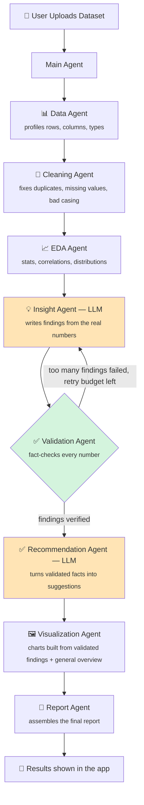

#  NexAnalyst - Multi Agent Data Analytics System

An autonomous, multi-agent AI Data Analyst. Upload any CSV or Excel file, and **8 specialized AI agents** work together to clean it, analyze it, find real insights, double-check those insights against the actual numbers, suggest what to do about them, build charts, and write a full report — all automatically.

Built with **LangGraph**, **Pandas**, **Plotly**, and **Streamlit**, powered by **Groq's free-tier LLM**.

---

## ✅ Status

All phases complete — fully built, tested, and working end to end.

---

## 🧠 What Makes This Different

Most "AI data analysis" tools just hand raw data to an LLM and hope for the best. This project doesn't:

- **Pandas/NumPy do every actual calculation** (averages, correlations, outliers) — never the LLM.
- **The LLM only writes about numbers that already exist.** It reads the real computed statistics and explains them — it's never allowed to invent a number.
- **Every AI-written insight gets fact-checked by code**, not by another AI. A dedicated Validation Agent compares every number the LLM cites against the real, pre-computed statistics. If too many findings don't check out, the system automatically asks the AI to try again.
- **Facts and AI opinions are kept visibly separate.** A recommendation always shows "here's the fact" next to "here's the AI's suggestion" — never blended together.

---

## 🗺️ How It Works (Pipeline)



*Boxes in orange call the AI (Groq). Everything else is deterministic Python/Pandas — same input always gives the same output.*

### What each agent actually does

| # | Agent | Uses AI? | Job |
|---|---|:---:|---|
| 1 | **Data Agent** | ❌ | Reads the file, profiles rows/columns/types/missing values |
| 2 | **Cleaning Agent** | ❌ | Removes duplicates, fixes missing values & inconsistent text, flags (never invents) outliers |
| 3 | **EDA Agent** | ❌ | Computes statistics, correlations, distributions, group comparisons |
| 4 | **Insight Agent** | ✅ | Reads the computed stats, writes findings in plain English |
| 5 | **Validation Agent** | ❌ | Checks every number the AI cited against the real stats — rejects anything fabricated |
| 6 | **Recommendation Agent** | ✅ | Turns *validated* findings into practical suggestions |
| 7 | **Visualization Agent** | ❌ | Builds charts — prioritizing the validated findings, plus general overview charts |
| 8 | **Report Agent** | ❌ | Assembles everything into one downloadable report |

---

## 🛠️ Tech Stack

| Layer | Technology |
|---|---|
| Agent orchestration | **LangGraph** |
| AI / LLM | **Groq** (free tier) — model: `openai/gpt-oss-120b` |
| Data processing | **Pandas**, **NumPy** |
| Charts | **Plotly**, **statsmodels** |
| Web app | **Streamlit** |
| Excel support | **openpyxl** |
| Config | **python-dotenv** |


---

## 🚀 Setup (Windows)

**1. Open the project folder in PowerShell, then create a virtual environment:**
```powershell
python -m venv venv
venv\Scripts\activate
```
> If PowerShell blocks the activation script, run this once:
> `Set-ExecutionPolicy -Scope CurrentUser -ExecutionPolicy RemoteSigned`

**2. Install dependencies:**
```powershell
pip install -r requirements.txt
```

**3. Get a free Groq API key** (no credit card needed):
Go to [console.groq.com](https://console.groq.com) → sign up → **API Keys** → **Create API Key**

**4. Set up your `.env` file:**
```powershell
copy .env.example .env
```
Open `.env` and fill in:
```
GROQ_API_KEY=gsk_your_actual_key_here
GROQ_MODEL=openai/gpt-oss-120b
```

**5. Confirm the AI connection works:**
```powershell
python utils\llm_client.py
```
It should print `OK`.

---

## ▶️ Run the App

```powershell
streamlit run app.py
```

Opens automatically at `http://localhost:8501`. Then:
1. Upload a CSV or Excel file
2. Click **Start Analysis**
3. Watch each agent run live
4. Explore results across 7 tabs: **Data Profile · Cleaning · EDA · Insights · Recommendations · Charts · Report**
5. Download the final report as Markdown

---

## 🧪 Run the Tests

```powershell
pytest tests\ -v
```


---

## 📁 Project Structure

```
ai-data-analyst/
├── app.py                       # Streamlit web app
├── requirements.txt
├── .env / .env.example
│
├── agents/                      # One file per pipeline stage
│   ├── data_agent.py
│   ├── cleaning_agent.py
│   ├── eda_agent.py
│   ├── insight_agent.py           🤖 uses AI
│   ├── validation_agent.py
│   ├── recommendation_agent.py    🤖 uses AI
│   ├── visualization_agent.py
│   └── report_agent.py
│
├── graph/
│   └── workflow.py              # LangGraph pipeline + retry loop
│
├── state/
│   └── schema.py                # Shared data passed between agents
│
├── tools/                       # Pure logic functions — no AI, fully testable
│   ├── cleaning_tools.py
│   ├── stats_tools.py
│   ├── chart_tools.py
│   ├── insight_tools.py
│   ├── validation_tools.py
│   ├── recommendation_tools.py
│   └── report_tools.py
│
├── utils/
│   ├── data_loader.py
│   └── llm_client.py            # Groq connection
│
├── outputs/
│   ├── charts/                  # Generated chart files
│   └── reports/                 # Generated report files
│
├── sample_data/                 # Example dataset for testing
└── tests/                       
```

---

## ⚠️ Known Limitations

- **Free Groq rate limits** — about 30 requests/minute, 14,400/day. Plenty for normal use. If you hit the limit, wait a bit, or switch to a smaller model (`openai/gpt-oss-20b`) in `.env`.
- **Best tested on CSV files** — Excel works but has had less real-world testing.
- **Chart count is capped** (to keep the UI clean) — on datasets with very many columns, not every single column gets its own chart.
- **One table at a time** — no joining multiple files or spreadsheet tabs together.

---

## 🔮 Ideas for Later (not built yet)

- **ML Agent** — forecasting, regression/classification, clustering (with safety limits like a minimum row count)
- **Chat box** — ask follow-up questions about your data directly ("Why did revenue drop in March?")
- **PDF export** — report currently downloads as Markdown, kept simple on purpose to avoid extra system dependencies